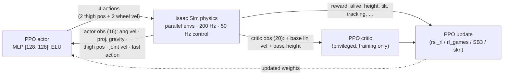

<div align="center">

# Wheeled Quadruped Robot: Deep RL in Isaac Lab

### A self-balancing wheeled quadruped that learns to stand upright, and to drive, with Deep Reinforcement Learning (PPO) in NVIDIA Isaac Lab

The robot stands pitched up, balancing segway-style on its two rear wheels. Using massively parallel simulation in **NVIDIA Isaac Lab / Isaac Sim**, a **PPO** policy learns to keep the body upright at a target height and to follow velocity commands, actuating its rear wheels and front thighs from **onboard sensing alone**, across thousands of environments trained in parallel on the GPU.

[](https://isaac-sim.github.io/IsaacLab/)
[](https://developer.nvidia.com/isaac-sim)
[](https://www.python.org/)
[](https://pytorch.org/)
[](https://arxiv.org/abs/1707.06347)
[](LICENSE)

<br/>


<sub><i>The trained velocity policy driving across uneven terrain while balancing. Full clip: <a href="docs/videos/hero_demo.mp4">hero_demo.mp4</a></i></sub>

</div>

> [!NOTE]
> **This is a learning project, built in public.** It started as my hands-on way of teaching myself NVIDIA Isaac Lab from an online example, and I have kept rebuilding and extending it as I learn. The original Isaac Lab 2.3.2 project shipped four trained policies, but the "learning in public" spirit stays: the honest scope, the mistakes fixed along the way (see the base-height sign bug below), and the open roadmap are all part of the point.

> **3.x migration:** This branch targets Isaac Lab **main** with **Isaac Sim 6.2**,
> **PhysX**, and **RSL-RL PPO** through the standard CLI. See
> [the migration report](docs/MIGRATION_ISAACLAB_3.md) for the audited framework
> revision, API mappings, static check results, and required container tests.
> The demonstrations and pretrained checkpoints below are historical 2.x results;
> they have not been validated with the migrated simulator or RSL-RL 5.

## Trained policies in action

Six tasks are registered and four policies are trained end to end in this repo, all **shipped ready to use** in [`pretrained/`](pretrained/). The GIFs below show the exported checkpoints running headless in Isaac Sim.

<div align="center">

| **Drive while balancing** (velocity task) | **Balance in place** (balance task) |
|:---:|:---:|
|  |  |
| Tracks a commanded forward and yaw velocity, staying upright the full 20 s episode. | Holds the upright 0.828 m target for the full episode. |

<sub><i>Full-resolution clips: <a href="docs/videos/velocity_demo.mp4">velocity_demo.mp4</a> · <a href="docs/videos/balance_demo.mp4">balance_demo.mp4</a></i></sub>

<br/><br/>

**On uneven ground.** The same tasks trained on generated rough terrain (random roughness plus gentle slopes, with a terrain-difficulty curriculum):

| **Drive on rough terrain** (velocity-rough) | **Balance on rough terrain** (balance-rough) |
|:---:|:---:|
|  |  |
| Tracks a forward command while rolling over bumps and slopes. | Stays upright on uneven ground under random pushes. |

<sub><i>Full-resolution clips: <a href="docs/videos/velocity_rough_demo.mp4">velocity_rough_demo.mp4</a> · <a href="docs/videos/balance_rough_demo.mp4">balance_rough_demo.mp4</a></i></sub>

</div>

---

## Table of contents

- [Overview](#overview)
- [How it works](#how-it-works)
- [Tasks](#tasks)
- [The robot](#the-robot)
- [Repository layout](#repository-layout)
- [Prerequisites](#prerequisites)
- [Installation](#installation)
- [Usage](#usage)
- [PPO hyperparameters](#ppo-hyperparameters)
- [Results](#results)
- [Pretrained models](#pretrained-models)
- [Documentation](#documentation)
- [Notes and limitations](#notes-and-limitations)
- [Roadmap](#roadmap)
- [Acknowledgements](#acknowledgements)
- [Citation](#citation)
- [License](#license)

## Overview

This project trains a **wheeled quadruped**, a four-legged robot whose rear feet are driven wheels, to **balance and stay standing** and to **drive while balancing**, using deep reinforcement learning. It is built as a standalone **[NVIDIA Isaac Lab](https://isaac-sim.github.io/IsaacLab/) 3.x** external project (the modern `isaaclab` package namespace, not the legacy `omni.isaac.lab`), using Isaac Lab's **manager-based RL environment** API.

The control problem is a **3D inverted-pendulum / self-balancing** task. The robot is pitched up, resting on its two rear wheels at a base height of **0.828 m**, and the policy must actuate the rear wheels and front thigh joints so the torso stays near that upright target and does not tip over. Training runs across thousands of **parallel environments** on the GPU and is optimized with **Proximal Policy Optimization (PPO)**.

A defining design choice is that **the policy only ever sees quantities a real robot could measure onboard**: body-frame angular velocity, a gravity direction estimate from an IMU, joint positions, joint velocities, and its own last action. It never sees its world-frame linear velocity or absolute height. To keep learning tractable anyway, the value function does get those privileged signals during training, an **asymmetric actor-critic**, because they are trivially available in simulation but only used to shape the critic, which is discarded at deployment.

The tasks are registered as Gymnasium environments. The migrated task registrations expose **RSL-RL PPO** through Isaac Lab's standard training workflow, and the standard CLI loads the external task package automatically. Legacy `scripts/rsl_rl/` wrappers are retained but not migrated.

## How it works

Each task is a **Markov Decision Process** solved with PPO. Physics runs at **200 Hz** (`sim.dt = 0.005`) and the policy acts every **4th** physics step (`decimation = 4`), giving a **50 Hz** control rate. Episodes last **20 s** (1000 control steps).

### Observations: asymmetric actor-critic

The **policy (actor)** reads only onboard-obtainable state, with observation noise applied during training:

| Term | Size | Onboard source |
|---|:---:|---|
| Base angular velocity | 3 | IMU gyroscope (body frame) |
| Projected gravity | 3 | IMU accelerometer, gravity direction |
| Front-thigh joint positions | 2 | Thigh joint encoders |
| Joint velocities | 4 | Joint encoders (2 wheels + 2 thighs) |
| Last action | 4 | Previous command, fed back for smoothness |
| **Policy total** | **16** | |

The **critic (value function only)** additionally sees **privileged** simulation-only state. It is used purely to reduce value-estimate variance during training and is thrown away at deployment:

| Term | Size | Note |
|---|:---:|---|
| Base **linear** velocity | 3 | **Privileged**, not measurable onboard |
| Base angular velocity | 3 | |
| Projected gravity | 3 | |
| Base **height** (z) | 1 | **Privileged** |
| Front-thigh joint positions | 2 | |
| Joint velocities | 4 | |
| Last action | 4 | |
| **Critic total** | **20** | |

The velocity tasks append the 3-value velocity command to both groups (policy 19, critic 23).

### Actions: 4 continuous values

| Actuator | Joints | Control | Scale |
|---|---|---|:---:|
| Front thighs | `robot1_front_left_thigh_joint`, `robot1_front_right_thigh_joint` | Joint **position** (offset from default) | 0.5 |
| Rear wheels | `robot1_rl_wheel_joint`, `robot1_rr_wheel_joint` | Joint **velocity** | 5.0 (balance) / 12.0 (velocity) |

The two front wheels are **fixed** and stay that way. Only these four joints are actuated.

### Rewards (balance task)

Weights are read directly from [`balance_env_cfg.py`](source/wheeled_quadruped/wheeled_quadruped/tasks/balance/balance_env_cfg.py):

| Term | Function | Weight | Purpose |
|---|---|:---:|---|
| `alive` | `is_alive` | **+1.0** | Reward for every surviving step |
| `terminating` | `is_terminated` | **-2.0** | Penalty for falling / early termination |
| `base_height` | `base_height_l2` (target 0.828 m) | **-20.0** | **Primary objective**, hold the balancing height |
| `flat_orientation` | `flat_orientation_l2` | **-5.0** | Keep the torso upright |
| `lin_vel_z` | `lin_vel_z_l2` | **-2.0** | Damp vertical bouncing |
| `ang_vel_xy` | `ang_vel_xy_l2` | **-0.05** | Damp roll/pitch wobble |
| `joint_torques` | `joint_torques_l2` | **-1.0e-5** | Effort penalty |
| `joint_acc` | `joint_acc_l2` | **-2.5e-7** | Smoothness (jerk) penalty |
| `action_rate` | `action_rate_l2` | **-0.01** | Penalize twitchy commands |
| `wheel_spin` | `joint_vel_l2` (wheels) | **-1.0e-3** | Stop the robot driving away while "balancing" |

The velocity tasks add exponential velocity-tracking rewards (`track_lin_vel_xy_exp`, `track_ang_vel_z_exp`), remove the wheel-spin penalty, and soften the balance-hold shaping so the policy is free to drive.

### Terminations

| Condition | Trigger |
|---|---|
| Time-out | Episode reaches **20 s** |
| `bad_orientation` | Torso tilts more than **pi/3 (60 degrees)** from upright |
| `base_too_low` | Base height drops below **0.4 m** (it has fallen) |

### Scene and simulation

Thousands of parallel environments, ground plane (or generated rough terrain), dome and distant lighting. Wheels use velocity-mode implicit actuators (zero stiffness, damping 10); thighs use position-mode actuators (stiffness 1000, damping 20). PhysX runs 8 position solver iterations for rolling-contact stability.



## Tasks

| Task id | Description | Config |
|---|---|---|
| `Wheeled-Quadruped-Balance` | Stand and balance in place on the rear wheels | `WheeledQuadrupedBalanceEnvCfg` |
| `Wheeled-Quadruped-Balance-Play` | Balance, eval variant (32 envs, no noise, no pushes) | `WheeledQuadrupedBalanceEnvCfg_PLAY` |
| `Custom-Wheeled-Quadruped` | Legacy alias, same balance config | `WheeledQuadrupedBalanceEnvCfg` |
| `Wheeled-Quadruped-Velocity` | Drive to a commanded forward/yaw velocity while balancing | `WheeledQuadrupedVelocityEnvCfg` |
| `Wheeled-Quadruped-Velocity-Play` | Velocity, eval variant (fixed forward command) | `WheeledQuadrupedVelocityEnvCfg_PLAY` |
| `Wheeled-Quadruped-Balance-Rough` | Balance on uneven ground (generated rough terrain) | `WheeledQuadrupedBalanceRoughEnvCfg` |
| `Wheeled-Quadruped-Velocity-Rough` | Drive while balancing on uneven ground, with a terrain curriculum | `WheeledQuadrupedVelocityRoughEnvCfg` |

*(Each rough task also has a `-Rough-Play` eval variant.)*

The velocity task extends the balancer. It adds a `UniformVelocityCommand` (with lateral velocity pinned to zero, since a two-wheel stance cannot translate sideways), appends the command to both observation groups, adds exponential velocity-tracking rewards, and softens the balance-hold shaping so the policy is free to drive. See [docs/TRAINING.md](docs/TRAINING.md) for the full design.

### Rough terrain (uneven ground)

The `*-Rough` tasks swap the flat ground plane for a **generated rough terrain** ([`source/wheeled_quadruped/wheeled_quadruped/terrains/`](source/wheeled_quadruped/wheeled_quadruped/terrains/__init__.py)) so the policy learns to stay up on uneven surfaces. Because a two-wheel balancer cannot climb stairs, the terrain is tuned for wheels: **low-amplitude random roughness (roughly 1 to 6 cm) plus gentle slopes (up to about 11 degrees), no stairs or boxes**. The velocity-rough task adds a **terrain-level curriculum** (`terrain_levels_vel`): robots that track their command well are promoted to rougher tiles, and those that fall behind are demoted. Train them exactly like the flat tasks:

```bash
uv run --extra isaacsim --with-editable "$ROBOT_PACKAGE" isaaclab train --rl_library rsl_rl --task Wheeled-Quadruped-Balance-Rough --num_envs 2048 physics=isaacsim_physx visualizer=none
uv run --extra isaacsim --with-editable "$ROBOT_PACKAGE" isaaclab train --rl_library rsl_rl --task Wheeled-Quadruped-Velocity-Rough --num_envs 2048 physics=isaacsim_physx visualizer=none
```

## The robot

The robot is described in `src/robot_description/` as a **ROS 2 (ament) package**: URDF/xacro parts (base, four thighs, leg joints, shins, front and rear wheels) with DAE/STL meshes, exported to a **USD** articulation (`quadruped_robot.usd`) for simulation in Isaac Sim. Joints are prefixed `robot1_*`. Only **four joints are actuated**: the two rear wheels (`*_rl_wheel_joint`, `*_rr_wheel_joint`, continuous) and the two front thighs (`*_front_left_thigh_joint`, `*_front_right_thigh_joint`, revolute, plus or minus 0.785 rad). The front wheels are fixed.

## Repository layout

```
wheeled_quadruped_robot/
├── README.md
├── LICENSE                              # MIT (+ Isaac Lab BSD-3-Clause attribution)
├── CITATION.cff
├── docs/
│   ├── images/  videos/                 # demo GIFs and clips used in this README
│   ├── wiki/                            # 12-page textbook-style project wiki
│   ├── SETUP_WINDOWS.md                 # Windows bring-up runbook
│   └── TRAINING.md                      # RL design document (obs/reward/event rationale)
├── pretrained/                          # 4 trained policies: ONNX + TorchScript + checkpoint
├── sim2sim_mujoco/                      # cross-engine validation: run the policies in MuJoCo
├── scripts/
│   ├── list_envs.py                     # list every registered Wheeled-Quadruped task
│   ├── verify_env.py                    # smoke test: load env, random rollout, NaN/Inf checks
│   ├── eval_tracking.py                 # measure real commanded-vs-achieved velocity error
│   └── rsl_rl/                          # train.py, play.py, cli_args.py
├── source/
│   └── wheeled_quadruped/               # installable Isaac Lab extension package
│       ├── pyproject.toml
│       └── wheeled_quadruped/
│           ├── assets/                  # WHEELED_QUADRUPED_CFG + quadruped_robot.usd
│           ├── terrains/                # wheel-traversable rough terrain generator
│           └── tasks/                   # balance/ and velocity/ (flat + rough variants)
└── src/robot_description/               # ROS 2 URDF/xacro description + meshes for the robot
```

## Prerequisites

- An NVIDIA GPU and driver supported by **Isaac Sim 6.2**.
- A fresh **Isaac Lab main** checkout and its supported **Python 3.12 / uv** environment.
- Use the framework workspace's dependency versions and overrides; do not upgrade an old 2.x virtual environment in place.

## Installation

This remains an external task package in `source/wheeled_quadruped`. Run the
following from your Isaac Lab main checkout (replace the package path if needed):

```bash
export ROBOT_PACKAGE=/workspace/wheeled_quadruped_robot/source/wheeled_quadruped
uv sync --extra isaacsim
uv run --extra isaacsim --with-editable "$ROBOT_PACKAGE" isaaclab list_envs
```

The package's `isaaclab.tasks` entry point makes all nine task IDs discoverable.
A bare `import wheeled_quadruped` is passive; direct Gymnasium users must import
`wheeled_quadruped.tasks` before looking up task IDs. Canonical task IDs no longer
have the `-v0` suffix. Only RSL-RL is advertised by the migrated registrations.
The old alternative-agent YAML files and custom scripts are retained as legacy
material and are outside this migration's supported workflow.

### Verify the configuration

From the same Isaac Lab checkout:

```bash
uv run --extra isaacsim --with-editable "$ROBOT_PACKAGE" --with pytest python -m pytest /workspace/wheeled_quadruped_robot/tests/test_migration_config.py -q
```

This constructs real framework configurations without starting the simulator.
It does not validate physics or training. Before training, run the container
acceptance checks in [the migration report](docs/MIGRATION_ISAACLAB_3.md).
Do not use the legacy `scripts/verify_env.py` as a 3.x acceptance test.

## Usage

Continue in the Isaac Lab main checkout with `ROBOT_PACKAGE` set as above:

```bash
# PhysX random-action smoke test (requires the Isaac Sim runtime)
uv run --extra isaacsim --with-editable "$ROBOT_PACKAGE" isaaclab random_agent --task Wheeled-Quadruped-Balance --num_envs 8 --max_steps 1000 physics=isaacsim_physx visualizer=none

# PPO training; use fewer environments first for the acceptance test
uv run --extra isaacsim --with-editable "$ROBOT_PACKAGE" isaaclab train --rl_library rsl_rl --task Wheeled-Quadruped-Balance --num_envs 2048 physics=isaacsim_physx visualizer=none
uv run --extra isaacsim --with-editable "$ROBOT_PACKAGE" isaaclab train --rl_library rsl_rl --task Wheeled-Quadruped-Velocity --num_envs 2048 physics=isaacsim_physx visualizer=none

# Play a checkpoint produced by the migrated RSL-RL 5 runner
uv run --extra isaacsim --with-editable "$ROBOT_PACKAGE" isaaclab play --rl_library rsl_rl --task Wheeled-Quadruped-Velocity-Play --num_envs 32 --checkpoint /absolute/path/to/new/model.pt physics=isaacsim_physx visualizer=kit
```

Use `visualizer=none` for headless execution, or `visualizer=kit` for interactive
viewing. Logs go under the Isaac Lab working directory's
`logs/rsl_rl/<experiment_name>/`. The preserved `*-Play` configurations disable
noise and pushes and fix the velocity command for evaluation. Rough task
variants use the same commands with their corresponding task IDs.

The custom `scripts/rsl_rl/train.py`, `play.py`, `scripts/verify_env.py`,
and other legacy scripts have **not** been migrated. The old 2.x checkpoints
use a different RSL-RL model/state layout; do not assume they can resume or play
with the new runner. Their exported MuJoCo/ONNX workflows remain separate.

## PPO hyperparameters

From the rsl_rl agent configs ([balance](source/wheeled_quadruped/wheeled_quadruped/tasks/balance/agents/rsl_rl_ppo_cfg.py), [velocity](source/wheeled_quadruped/wheeled_quadruped/tasks/velocity/agents/rsl_rl_ppo_cfg.py)):

| Parameter | Balance | Velocity |
|---|:---:|:---:|
| Actor / critic MLP | [128, 128], ELU | [256, 128, 64], ELU |
| Steps per env (rollout) | 24 | 24 |
| Max iterations | 1000 | 3000 |
| Learning rate | 1e-3 (adaptive) | 1e-3 (adaptive) |
| Discount `gamma` | 0.99 | 0.99 |
| GAE `lambda` | 0.95 | 0.95 |
| Clip range | 0.2 | 0.2 |
| Entropy coef. | 0.005 | 0.005 |
| Learning epochs | 5 | 5 |
| Mini-batches | 4 | 4 |
| Desired KL | 0.01 | 0.01 |
| Value-loss coef. | 1.0 | 1.0 |
| Init. action noise std | 1.0 | 1.0 |
| Empirical normalization | off | off |

The actor reads the `policy` observation group and the critic reads the `critic` group; this mapping is declared in the runner cfg via `obs_groups = {"actor": ["policy"], "critic": ["critic"]}` in RSL-RL 5. The actor and critic now have separate MLP model configurations.

## Results

All policies were trained to convergence on a single RTX 4090 Laptop GPU (16 GB), 2048 environments, headless. Episode length is out of **1000** control steps (a full 20 s episode); the tracking scores are the mean exponential-kernel reward in `[0, 1]`.

| Task | Iterations | Mean reward | Episode length | Lin-vel tracking | Yaw tracking |
|---|:---:|:---:|:---:|:---:|:---:|
| **Balance** (flat) | 1000 | approx 19.5 | **1000 / 1000** | | |
| **Velocity** (flat) | 3000 | approx 36.5 | **996 / 1000** | approx 0.82 | approx 0.85 |
| **Balance-rough** | 1500 | approx 7.5 | approx 948 / 1000 | | |
| **Velocity-rough** | 3000 | approx 18.4 | approx 878 / 1000 | approx 0.55 | approx 0.30 |

The balancer learned to stand in a sharp transition around iteration 500 to 600 (episode length jumping from about 13 steps to the full episode). The velocity policy learned to stay up and follow commands remarkably fast (episode length about 886 by iteration 200), then spent the rest of training refining accuracy. The rough-terrain policies converge a bit lower: uneven ground plus random pushes occasionally topple the robot, so episode length settles below the flat 1000 and tracking accuracy is lower, but both clearly learn to stay up and drive across the bumps, with the terrain curriculum steadily promoting robots to rougher tiles.

### Tuning the yaw tracking

Yaw tracking originally plateaued below linear tracking. Raising the `track_ang_vel_z` reward weight (0.5 to 1.0) and tightening its kernel (`std` sqrt(0.25) to sqrt(0.15)) closed the gap on flat ground. Measured as **physical commanded-vs-achieved error** with [`scripts/eval_tracking.py`](scripts/eval_tracking.py) (masked to upright timesteps, so falls do not skew it):

| Policy | Linear error (MAE) | Yaw error, turning (MAE) |
|---|:---:|:---:|
| Flat velocity, original | 0.174 m/s | 0.149 rad/s |
| Flat velocity, **yaw-tuned** | 0.171 m/s | **0.128 rad/s** (14% lower) |

On flat ground the tuning is a clean win: yaw error drops about 14% with linear tracking unchanged, so the flat velocity policy shipped in [`pretrained/velocity/`](pretrained/velocity/) uses it. On rough terrain the same change traded roughly 26% worse forward-speed tracking for its yaw gain, so the rough velocity task keeps the balanced weights and its original policy.

## Sim-to-sim validation (MuJoCo)

The policies are trained in Isaac Sim (PhysX). To check they are not overfit to one physics engine, [`sim2sim_mujoco/`](sim2sim_mujoco/) runs the exact same exported actors in **MuJoCo**, an independent simulator, which is a cheap rehearsal for the eventual sim-to-real gap. The MuJoCo model is rebuilt from the robot URDF (so it is a genuine cross-engine test, not a replay), with observations, joint order, and actuators matched to the Isaac task; the actor runs in pure numpy.

<div align="center">


<sub><i>The same trained policy running in MuJoCo, a different physics engine from the one it was trained in. Full clip: <a href="docs/videos/sim2sim_demo.mp4">sim2sim_demo.mp4</a></i></sub>

</div>

| Policy | MuJoCo episode length | Full-episode survival |
|---|:---:|:---:|
| Balance | 1000 / 1000 | 100% |
| Velocity | 1000 / 1000 | 100% |
| Balance-rough | 1000 / 1000 | 100% |
| Velocity-rough | ~956 / 1000 | 20% (stays up ~96%) |

All four policies transfer well to MuJoCo. The three simplest survive every episode; the hardest task (drive while balancing on rough terrain) stays up about 96% of the episode on average and tracks its command closely, but it is the only one that ever falls, the useful and honest signal from a sim-to-sim check that flags the policy closest to the edge of its robustness. See [`sim2sim_mujoco/README.md`](sim2sim_mujoco/README.md) for how it works and how to run it.

## Pretrained models

All four trained policies are committed in [`pretrained/`](pretrained/) for immediate use, no training required: `balance/`, `velocity/`, `balance_rough/`, and `velocity_rough/`. Each task folder ships three forms of the same network:

| File | Format | Use it for |
|---|---|---|
| `policy.onnx` | ONNX | Framework-agnostic inference (onnxruntime): deployment, C++, other runtimes |
| `policy_torchscript.pt` | TorchScript | Standalone PyTorch inference without Isaac Lab installed |
| `model_*.pt` | rsl-rl checkpoint | Historical RSL-RL 3 checkpoint; conversion/retraining required for the new runner |

The shipped checkpoints were trained with Isaac Lab 2.x. Their compatibility
with RSL-RL 5 has not been established. Use a newly trained 3.x checkpoint with
the standard play command in [Usage](#usage).

The exported `policy.onnx` / `policy_torchscript.pt` contain only the actor MLP and its observation normalizer, that is, the **onboard-only** deployable policy, with the privileged critic already stripped. See [`pretrained/README.md`](pretrained/README.md) for the observation layout and a minimal ONNX inference example.

## Documentation

A full, textbook-style **[project wiki](docs/wiki/Home.md)** (`docs/wiki/`) explains everything: the robot, RL/MDP foundations, Isaac Lab's architecture, both task specifications, the PPO math, the asymmetric actor-critic and sim-to-real, the code architecture, and a reproduction manual, in both plain language and full mathematics. Start at [`docs/wiki/Home.md`](docs/wiki/Home.md). See also [docs/SETUP_WINDOWS.md](docs/SETUP_WINDOWS.md) (install runbook) and [docs/TRAINING.md](docs/TRAINING.md) (RL design notes).

## Notes and limitations

- **Onboard-only policy, privileged critic.** The actor never sees base linear velocity or absolute height. This is intentional for sim-to-real; the critic's extra signals exist only to stabilize training and are discarded at deployment.
- **Rough terrain is harder, and honestly so.** The rough-terrain policies stay up roughly 90 to 95% of an episode rather than the full 1000 steps, and their tracking is looser than on flat ground. That is expected on uneven terrain with random pushes, and it is reported as-is rather than cherry-picked.
- **rl_games / SB3 batch-size coupling.** Those YAML configs assume `num_envs = 4096` (rollout = `num_envs x n_steps`). If you change `--num_envs`, the `minibatch_size` / `batch_size` must still evenly divide the rollout; see [docs/SETUP_WINDOWS.md](docs/SETUP_WINDOWS.md).
- **USD is a committed binary.** `quadruped_robot.usd` (about 18 MB) is tracked directly and marked binary in `.gitattributes`. If the asset grows, migrate it to Git LFS.
- **Not yet on hardware.** All policies are trained and validated in simulation only; physical deployment (sim-to-real) is the next milestone.

## Roadmap

- [x] Redesign observations/rewards with an asymmetric actor-critic and onboard-only actor obs.
- [x] Fix the base-height reward sign; add the full effort/smoothness reward suite.
- [x] Domain randomization (mass, friction, restitution, resets, pushes).
- [x] Velocity-command tracking task; trained to convergence and shipped.
- [x] Rough-terrain tasks (uneven ground) with a terrain-level curriculum, trained and shipped.
- [x] Tune the velocity yaw tracking (clean win on flat ground).
- [x] Commit trained checkpoints and demo clips (see [`pretrained/`](pretrained/)).
- [x] Sim-to-sim validation in MuJoCo (see [`sim2sim_mujoco/`](sim2sim_mujoco/)).
- [ ] Recover the rough-terrain yaw gain without the linear-tracking trade-off, and firm up velocity-rough transfer.
- [ ] Sim-to-real: deploy the onboard-only policy on the physical robot.
- [ ] USD/asset hygiene: move the USD to Git LFS if it grows.

## Acknowledgements

- **[NVIDIA Isaac Lab](https://github.com/isaac-sim/IsaacLab)**, the RL framework and manager-based environment API this project is built on (BSD-3-Clause). The train/play/CLI scripts and the config structure are adapted from Isaac Lab's velocity locomotion task; those files retain their original BSD-3-Clause headers.
- **`src/robot_description/`**, the robot's ROS 2 URDF/xacro description and meshes.

## Citation

If you use this work, please cite it and Isaac Lab:

```bibtex
@software{asfaw_wheeled_quadruped,
  author  = {Asfaw, Mickyas Tamiru},
  title   = {Wheeled Quadruped Robot: Deep RL in Isaac Lab},
  url     = {https://github.com/MickyasTA/wheeled_quadruped_robot},
  year    = {2026}
}

@article{mittal2023orbit,
  author  = {Mittal, Mayank and others},
  title   = {Orbit: A Unified Simulation Framework for Interactive Robot Learning Environments},
  journal = {IEEE Robotics and Automation Letters},
  year    = {2023},
  doi     = {10.1109/LRA.2023.3270034}
}
```

## License

Released under the [MIT License](LICENSE). This project builds on **NVIDIA Isaac Lab** (BSD-3-Clause); several files under `source/` and `scripts/` retain their original Isaac Lab BSD-3-Clause headers. See [LICENSE](LICENSE) for the third-party attributions.
